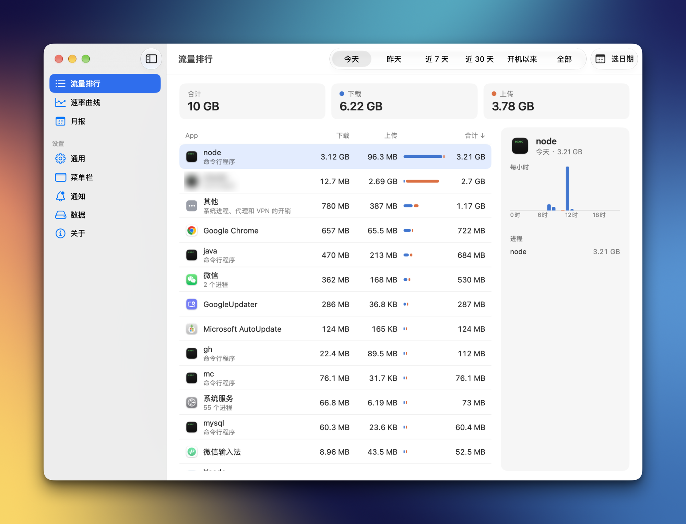

<h3 align="center">NetTick</h3>

<p align="center">
  <strong>macOS 菜单栏流量监控。</strong><br>
  菜单栏上看实时的上传、下载速率；按 App 记每天用了多少流量。
</p>

<p align="center">
  
  
  <a href="./LICENSE"></a>
</p>

<p align="center">
  <a href="#安装">🚀 <strong>安装</strong></a> ｜ <a href="https://www.lifedever.com">💖 <strong>赞助</strong></a>
</p>

<p align="center">
  
</p>

---

## 菜单栏和面板

- 菜单栏两行，上面上传、下面下载，可以带箭头或不带。
- 点开是面板：最近 60 秒的速率、正在用网的 App、今天各 App 用了多少。
- 「正在用网」固定 3 行，高度不跳。停了的 App 变灰沉到下面，有新 App 联网时顶上来。
- 面板可以固定，点别处不收起。

## 主窗口

- **流量排行**：今天、昨天、近 7 天、近 30 天、全部，或者选一天。点一个 App，右边是它每小时或每天的量和各个进程。
- **速率曲线**：最近 1 小时或 24 小时，点曲线上一处，看那一刻是哪些 App 在用网。
- **月报**：本月合计、和上月同期比、每天的量、用得最多的 App。

## 其他

- 新程序第一次联网时通知，只通知，不拦截。
- 开机时启动，默认关。
- 每天检查一次更新，装完自动重启。

## 怎么统计的

- 总速率读物理网卡（en*）的计数，不算虚拟网卡，开着 TUN 模式的代理也不会重复计数。
- 按 App 用系统的 NetworkStatistics 框架统计，不需要额外的权限。App 的 Helper 进程算在 App 名下。
- root 和其他系统账户的进程（比如系统更新）看不到是谁。网卡比各 App 多出来的部分记作「其他」，排行各行加起来等于网卡的量。
- 数据只存在本机：`~/Library/Application Support/com.lifedever.NetTick/nettick.sqlite`。只有检查更新时会访问 GitHub。

## 安装

从 [Releases](https://github.com/lifedever/NetTick/releases/latest) 下载 `NetTick-版本号-arm64.dmg`，把 NetTick 拖进「应用程序」。

App 没有公证，第一次打开会被系统拦下，到「系统设置 → 隐私与安全性」里点「仍要打开」。

需要 macOS 14 或更新的系统、Apple 芯片的 Mac。

## 从源码构建

```bash
./scripts/setup-dev-cert.sh       # 生成本机签名证书：通知、登录项按签名认 App，每次构建签名不变
./scripts/build-app.sh --install  # 构建并装到 /Applications
```

## 赞助

NetTick 免费、开源。觉得有用的话，可以在 [lifedever.com](https://www.lifedever.com) 赞助支持。

## 许可

[MIT](./LICENSE)
